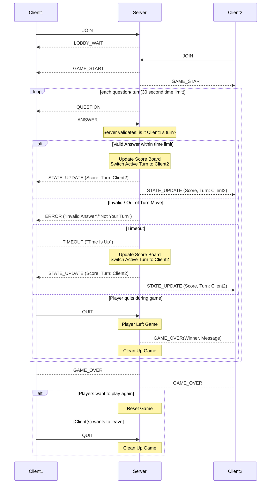

Brianna Miller 
CS457: Computer Networks and the Internet 
Sprint 2: Game Behavior & Server Concurrency Architecture Design 

### Detailed Architecture Specifications
#### Server Concurrency Model Selection
This trivia game will use multi-threading with a main thread for the server and two worker threads, one for each client socket. 
Having separate threads for each client will allow them to communicate with the server at the same time. The server will then be able to queue their requests before processing them in the game. Since the server is responsible for managing the shared resources in memory and preventing race conditions it can use a threading.Lock to coordinate access to resources that the threads could access at the same time.  
The server will initialize the game state then listen for incoming connections. When a client connects to the server, the server will accept the connection and create a worker thread associated with that client. Then the server will register that client by adding their information to the game setup and creating a player name (e.g, player1 and player2). Once both clients are registered the game can begin. 
The active game loop will be controlled by the server and players will take turns throughout the game answering questions. The server will assign the active player a multiple choice question. Afterwards, the player can respond with an answer. Once the server receives the player's response, it will validate the answer by checking the turn order and processing the response.Then the server will process the response to determine if the and broadcast the score and turn updates using a STATE_UPDATE message. Broadcasting the updates will reflect changes in the game state for both players at the same time. 
Error and timeout handling: 
If a player attempts to answer out of turn or submits an invalid answer the server will send and ERROR message informing the client and ignore the request. 
If a player fails to answer a question within the round's time limit then a TIMEOUT message will be sent and the scores and turn order will be updated.  
Once the game is complete and winner is determined, the server will broadcast the final scores by sending a GAME_OVER message. If a client indicates they want to quit by sending a QUIT message, then the server can begin handling the worker thread tear downs, closing the client connections and releasing the game's shared resources to end the game safely. Otherwise, the server will reset the game state and for the next game.

#### Mermaid Sequence Diagram

